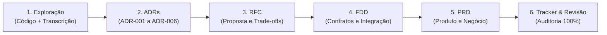

# Sistema de Webhooks de Notificação de Pedidos — Design Docs com IA

Documentação técnica e de produto elaborada para o desafio **"Da Reunião ao Documento: Design Docs Gerados por IA"** (MBA em Engenharia de Software com IA — Full Cycle).

---

## 1. Sobre o Desafio

Este desafio consiste em transformar a transcrição bruta de uma reunião técnica de ~55 minutos ([`TRANSCRICAO.md`](./TRANSCRICAO.md)) e o código-fonte existente de um **Order Management System (OMS)** em Node.js + TypeScript + Express + Prisma + MySQL em um pacote completo, coeso e acionável de **Design Docs** para a construção de um **Sistema de Webhooks Outbound de Notificação de Pedidos**.

O objetivo central é exercitar o papel de liderança técnica e curadoria junto à Inteligência Artificial: extrair decisões arquiteturais reais, separar com precisão o que entrou no escopo do que foi explicitamente descartado ou adiado na call, conectar as especificações aos módulos e arquivos reais do repositório (`src/` e `prisma/`) e estruturar cada documento na sua altura correta (**ADRs**, **RFC**, **FDD**, **PRD** e **Tracker de Rastreabilidade**), garantindo zero alucinação e 100% de rastreabilidade sem modificar nenhuma linha do código da aplicação.

---

## 2. Ferramentas de IA Utilizadas

- **Google Antigravity (Agente de Codificação e Arquitetura com Gemini):** Utilizado como ambiente principal de engenharia assistida por IA para leitura cruzada do código-fonte (`src/`, `prisma/schema.prisma`, `package.json`), análise estruturada da transcrição (`TRANSCRICAO.md`), planejamento da arquitetura documental, geração iterativa dos artefatos Markdown (`ADRs`, `RFC`, `FDD`, `PRD`, `TRACKER`) e auditoria automatizada de consistência contra os critérios de aceite.
- **Claude / Modelos LLM de Apoio para Revisão Crítica de Prompts:** Utilizados na formulação de prompts estruturados por papel (Tech Lead, Staff Engineer, Product Manager e Security Engineer) e na verificação de fronteiras de responsabilidade entre RFC (proposta arquitetural concisa) e FDD (especificação detalhada de implementação).

---

## 3. Workflow Adotado

O trabalho foi organizado em **6 etapas sequenciais** seguindo a estratégia *bottom-up* de decisões para especificação e consolidação executiva:



1. **Contextualização e Mapeamento (Transcrição + Código Base):**
   - Leitura integral de `TRANSCRICAO.md` classificando cada fala em: *(a)* decisão fechada, *(b)* alternativa descartada, *(c)* item fora de escopo / adiado, *(d)* questão em aberto, *(e)* requisito funcional/não funcional e *(f)* gancho com o código.
   - Inspeção estática do repositório mapeando `src/modules/orders/order.service.ts` (`changeStatus` e transação Prisma), `src/modules/orders/order.status.ts`, `prisma/schema.prisma`, `src/shared/errors/app-error.ts`, `src/shared/errors/http-errors.ts`, `src/middlewares/auth.middleware.ts`, `src/middlewares/error.middleware.ts`, `src/middlewares/validate.middleware.ts`, `src/shared/logger/index.ts`, `src/app.ts`, `src/routes/index.ts` e `src/server.ts`.
2. **Produção dos ADRs (`docs/adrs/ADR-001` a `ADR-006`):**
   - Formalização das 6 grandes decisões da reunião no formato MADR antes de redigir os documentos maiores, estabelecendo os alicerces do desenho técnico.
3. **Consolidação do RFC (`docs/RFC.md`):**
   - Redação da proposta arquitetural concisa submetida aos 5 participantes da reunião como revisores (`Larissa`, `Marcos`, `Bruno`, `Diego`, `Sofia`), documentando as alternativas descartadas, as questões deixadas em aberto e os links para os 6 ADRs.
4. **Detalhamento Técnico no FDD (`docs/FDD.md`):**
   - Especificação acionável para desenvolvimento: modelagem Prisma das 4 novas tabelas (`webhooks`, `webhook_outbox`, `webhook_deliveries`, `webhook_dead_letter`), fluxos em diagramas Mermaid, 7 endpoints HTTP + contrato do POST outbound, matriz de erros `WEBHOOK_*`, observabilidade (logs Pino, métricas e tracing) e a seção obrigatória de **Integração com o sistema existente** referenciando 11 arquivos reais do projeto.
5. **Consolidação de Produto no PRD (`docs/PRD.md`):**
   - Registro da visão de negócio (retenção da Atlas Comercial e atendimento a MaxDistribuição e Nova Cargo em 3 sprints), métricas quantitativas (< 10s de latência, ~15h de janela de retry, últimas 100 entregas), escopo incluso e 6 exclusões explícitas, 10 requisitos funcionais, 6 requisitos não funcionais e matriz de riscos com probabilidade, impacto e mitigação.
6. **Construção do Tracker (`docs/TRACKER.md`) e Auditoria Final:**
   - Mapeamento linha a linha de 112 itens identificáveis dos documentos para timestamps exatos de `TRANSCRICAO.md` (`[09:xx] Nome`) e arquivos de `CODIGO`, seguido de revisão contra a checklist de critérios de aceite.

---

## 4. Prompts Customizados

Abaixo estão 3 dos principais prompts dirigidos que foram escritos e utilizados para evitar respostas genéricas e garantir fidelidade estrita à transcrição e ao código:

### Prompt 1 — Extração Categorizada e Filtragem Anti-Alucinação da Transcrição

```markdown
Atue como um Staff Software Engineer e Tech Lead. Analise integralmente o arquivo `TRANSCRICAO.md` e os arquivos do repositório (`prisma/schema.prisma`, `src/modules/orders/order.service.ts`, `src/shared/errors/`, `src/middlewares/`, `src/shared/logger/index.ts`).

Faça uma extração estruturada classificando cada ponto discutido exatamente nas categorias abaixo, sempre citando o timestamp literal `[hh:mm] Nome` ou o caminho real do arquivo no código:
1. DECISÕES ARQUITETURAIS FECHADAS (o que foi aprovado e por quê).
2. ALTERNATIVAS CONSIDERADAS E DESCARTADAS (qual era a ideia, quem levantou e qual trade-off levou ao descarte).
3. FORA DE ESCOPO / ADIADOS PARA O FUTURO (ideias que foram explicitamente negadas para esta fase — ex: e-mail, dashboard visual, webhooks inbound, arquivamento de 30 dias).
4. QUESTÕES EM ABERTO / OBSERVAR EM PRODUÇÃO (ex: rate limiting de saída, escalabilidade multi-worker, endurecimento de roles no CRUD).
5. CONTRATOS, REQUISITOS E PARÂMETROS NUMÉRICOS EXATOS (tempos de polling, quantidades e intervalos de retry, tamanho máximo de payload, timeout HTTP, headers, campos do payload, regras de RBAC).

REGRA DE OURO: Não invente nenhum requisito, header, endpoint ou tecnologia que não esteja explicitamente na transcrição ou no código existente.
```

### Prompt 2 — Geração do FDD Acionável e Integração com o Código Existente

```markdown
Com base nas 6 decisões formalizadas nos ADRs (`ADR-001` a `ADR-006`), elabore o documento `docs/FDD.md` (Feature Design Document) para o Sistema de Webhooks de Notificação de Pedidos.

Restrições obrigatórias de qualidade e fronteira documental:
1. O FDD responde "COMO CONSTRUIR EM DETALHE". Não seja superficial: forneça os modelos Prisma propostos compatíveis com `prisma/schema.prisma` (usando `@id @default(uuid()) @db.Char(36)` conforme decidido em `[09:51] Larissa`), os fluxos passo a passo (outbox com snapshot na inserção, polling de 2s no worker, cálculo de HMAC-SHA256 com suporte ao grace period de 24h da secret antiga, backoff de 1m/5m/30m/2h/12h e replay da DLQ).
2. Na seção "Contratos Públicos", especifique todos os endpoints REST (`POST /api/v1/webhooks`, `GET /api/v1/webhooks`, `PATCH /api/v1/webhooks/:id`, `DELETE /api/v1/webhooks/:id`, `POST /api/v1/webhooks/:id/rotate-secret`, `GET /api/v1/webhooks/:id/deliveries`, `POST /api/v1/admin/webhooks/dead-letter/:id/replay`) com payloads JSON de request/response, status codes e o contrato do POST enviado ao cliente (sem `items`, com headers `X-Event-Id`, `X-Signature`, `X-Timestamp`, `X-Webhook-Id`).
3. Na "Matriz de Erros", utilize exclusivamente códigos com prefixo `WEBHOOK_` herdando de `AppError` (`src/shared/errors/app-error.ts`).
4. Na seção obrigatória "Integração com o sistema existente", referencie caminhos reais do repositório (`src/modules/orders/order.service.ts`, `prisma/schema.prisma`, `src/shared/errors/app-error.ts`, `src/shared/errors/http-errors.ts`, `src/middlewares/auth.middleware.ts`, `src/middlewares/error.middleware.ts`, `src/middlewares/validate.middleware.ts`, `src/shared/logger/index.ts`, `src/app.ts`, `src/routes/index.ts`, `src/server.ts`) explicando exatamente como `OrderService.changeStatus` chamará `publishWebhookEvent(tx, order, fromStatus, toStatus)` dentro de `this.prisma.$transaction`.
```

### Prompt 3 — Auditoria Cruzada e Construção do Tracker de Rastreabilidade

```markdown
Construa o arquivo `docs/TRACKER.md` mapeando todos os itens identificáveis de `docs/PRD.md`, `docs/RFC.md`, `docs/FDD.md` e `docs/adrs/ADR-001` a `ADR-006` na tabela obrigatória:
`| ID | Documento | Tipo | Conteúdo (resumo) | Fonte | Localização |`

Regras estritas de validação:
- `Fonte` deve ser exclusivamente `TRANSCRICAO` ou `CODIGO`.
- Quando `Fonte = TRANSCRICAO`, `Localização` deve conter um timestamp válido e verificado de `TRANSCRICAO.md` no formato exato `[hh:mm] Nome` (ex: `[09:17] Diego`).
- Quando `Fonte = CODIGO`, `Localização` deve conter um caminho de arquivo real existente no repositório (ex: `src/modules/orders/order.service.ts`).
- Verifique que pelo menos 80% de todos os itens dos documentos estão rastreados, pelo menos 70% das linhas têm `Fonte = TRANSCRICAO` e pelo menos 5 linhas têm `Fonte = CODIGO`. Se algum item nos documentos não tiver origem clara na transcrição ou no código, sinalize para remoção imediata.
```

---

## 5. Iterações e Ajustes

Durante o processo de produção, foram realizadas **4 iterações principais** de revisão crítica e refinamento sobre o material estruturado com a IA:

1. **Iteração 1 — Correção da Origem do `customerId` na Autenticação JWT (`[09:31]` vs `[09:32]`):**
   - *Problema identificado:* Em uma primeira leitura rápida da fala inicial do PM (`[09:31] Marcos`: *"Customer_id implícito do JWT"*), uma geração ingênua assumiria que o `customerId` vem dentro do token JWT.
   - *Ajuste realizado:* Ao cruzar a fala seguinte de `[09:32] Bruno` e `[09:32] Larissa` com o arquivo real `src/middlewares/auth.middleware.ts` (`AuthUser = { id, email, role: 'ADMIN' | 'OPERATOR' }`), confirmamos que o JWT pertence ao usuário operador/admin e **não** contém `customerId`. Ajustamos o `ADR-006`, o `FDD.md` e o `PRD.md` para documentar explicitamente que o `customerId` é passado no body/query dos endpoints de webhook e registramos a suposição inicial descartada como `ADR-006-ALT-02`.
2. **Iteração 2 — Detalhamento Técnico do Grace Period de 24h na Rotação de Secret (`[09:21] Sofia`):**
   - *Problema identificado:* O rascunho inicial mencionava que "a secret antiga vale por 24 horas após a rotação", mas não especificava como o banco de dados e o worker suportariam duas chaves válidas simultaneamente no envio outbound.
   - *Ajuste realizado:* Refinamos a modelagem da tabela `Webhook` no `docs/FDD.md` para incluir as colunas `previousSecret` e `previousSecretExpiresAt`, além de especificar o endpoint `POST /api/v1/webhooks/:id/rotate-secret` e o comportamento do header `X-Signature` durante a janela de 24 horas.
3. **Iteração 3 — Separação Rigorosa de Altura entre `RFC.md` e `FDD.md`:**
   - *Problema identificado:* Na primeira versão do RFC, detalhes de schemas de banco e payloads de endpoints começaram a vazar para dentro da proposta arquitetural, gerando redundância com o FDD.
   - *Ajuste realizado:* Enxugamos o `docs/RFC.md` para focar exclusivamente em contexto arquitetural, visão de alto nível, tabela comparativa das 6 alternativas descartadas na reunião e detalhamento das 5 questões deixadas em aberto, movendo todos os schemas Prisma, payloads JSON de request/response e matriz de códigos `WEBHOOK_*` para o `docs/FDD.md`.
4. **Iteração 4 — Conversão de Detalhes Finais da Call (`[09:50]`–`[09:53]`) em Especificação Acionável:**
   - *Problema identificado:* Após a saída de Marcos e Sofia da call (`[09:50]`), Larissa, Diego e Bruno tomaram duas decisões técnicas cruciais nos últimos 3 minutos: usar `UUID` na outbox (`[09:51] Larissa`) e armazenar o **snapshot do payload já renderizado na hora da inserção** em vez de renderizar na hora do envio (`[09:52] Larissa`).
   - *Ajuste realizado:* Incorporamos essas duas decisões tanto no `ADR-001` (incluindo a alternativa descartada `ADR-001-ALT-03`) quanto no fluxo transacional `publishWebhookEvent` do `docs/FDD.md` e no `docs/TRACKER.md`.

---

## 6. Como Navegar a Entrega

### Estrutura dos Arquivos Entregues

```text
.
├── README.md                                                              # Este documento (processo, workflow, prompts e guia de navegação)
├── TRANSCRICAO.md                                                         # Gravação literal da reunião técnica (intocada)
└── docs/
    ├── PRD.md                                                             # Product Requirements Document (visão de produto, métricas, escopo, requisitos e riscos)
    ├── RFC.md                                                             # Request for Comments (proposta arquitetural, alternativas descartadas e questões em aberto)
    ├── FDD.md                                                             # Feature Design Document (especificação técnica, fluxos, contratos HTTP, erros e integração)
    ├── TRACKER.md                                                         # Matriz de rastreabilidade cruzando 112 itens com TRANSCRICAO.md e o código-fonte
    └── adrs/
        ├── README.md                                                      # Índice navegável dos ADRs
        ├── ADR-001-outbox-no-mysql.md                                     # Decisão 1: Transactional Outbox no MySQL e snapshot na inserção
        ├── ADR-002-worker-em-processo-separado-em-polling.md              # Decisão 2: Worker em processo separado (src/worker.ts) em polling de 2s
        ├── ADR-003-politica-de-retry-com-backoff-e-dlq.md                 # Decisão 3: 5 tentativas com backoff (1m/5m/30m/2h/12h), DLQ separada e replay ADMIN
        ├── ADR-004-autenticacao-hmac-sha256-com-secret-por-endpoint.md    # Decisão 4: HMAC-SHA256 em X-Signature, secret por endpoint, TLS e rotação (24h)
        ├── ADR-005-garantia-at-least-once-com-x-event-id.md               # Decisão 5: Entrega at-least-once e deduplicação no cliente via X-Event-Id
        └── ADR-006-reuso-dos-padroes-existentes-do-projeto.md             # Decisão 6: Reuso de AppError (WEBHOOK_*), Pino, Zod, middlewares e estrutura modular
```

### Ordem Sugerida de Leitura

1. **[`docs/PRD.md`](./docs/PRD.md)** — Comece pelo PRD para entender o problema de negócio (Atlas Comercial, MaxDistribuição e Nova Cargo), as metas quantitativas, o que entra no escopo e o que foi explicitamente deixado de fora.
2. **[`docs/RFC.md`](./docs/RFC.md)** — Leia em seguida o RFC para compreender a arquitetura proposta em alto nível, por que as alternativas (HTTP síncrono, Redis Streams, triggers no MySQL, *exactly-once*) foram descartadas e quais questões ficaram em aberto.
3. **[`docs/adrs/` (`ADR-001` a `ADR-006`)](./docs/adrs/README.md)** — Consulte cada decisão arquitetural isolada com seu contexto, alternativas e trade-offs.
4. **[`docs/FDD.md`](./docs/FDD.md)** — Aprofunde-se na especificação de implementação: schema Prisma, diagramas de sequência/fluxo, contratos HTTP de request/response, matriz de erros `WEBHOOK_*`, observabilidade e tabela de integração com os arquivos reais do código (`src/` e `prisma/`).
5. **[`docs/TRACKER.md`](./docs/TRACKER.md)** — Utilize o Tracker para auditar a origem exata de cada requisito, decisão e integração na transcrição (`[hh:mm] Nome`) ou no código-fonte (`CODIGO`).
