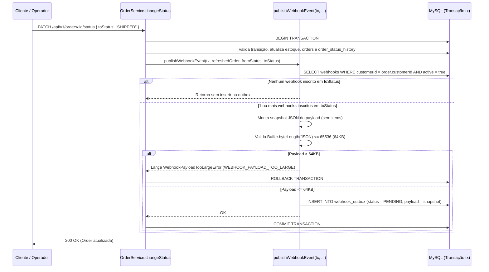
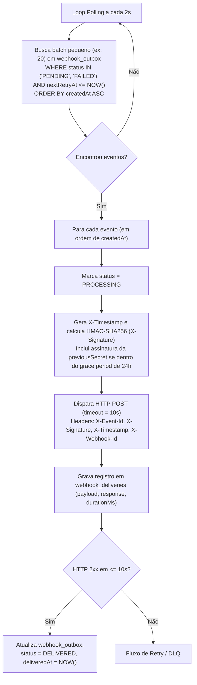

# FDD — Feature Design Document: Sistema de Webhooks de Notificação de Pedidos

- **ID do Documento:** `FDD-001`
- **Feature:** Sistema de Webhooks Outbound de Notificação de Pedidos
- **Documentos Relacionados:** [`docs/RFC.md`](./RFC.md), [`docs/PRD.md`](./PRD.md), [ADRs (`ADR-001` a `ADR-006`)](./adrs/README.md)

---

## 1. Contexto e Motivação Técnica

O Order Management System (OMS) gerencia o ciclo de vida de pedidos B2B através de uma máquina de estados determinística (`PENDING` → `PAID` → `PROCESSING` → `SHIPPED` → `DELIVERED`, além de transições para `CANCELLED`) definida em `src/modules/orders/order.status.ts` e persistida no MySQL via Prisma (`prisma/schema.prisma`).

Atualmente, a aplicação não possui eventos de domínio, filas ou webhooks. Clientes B2B (Atlas Comercial, MaxDistribuição e Nova Cargo) realizam polling constante em `GET /api/v1/orders` (`src/modules/orders/order.routes.ts`) para detectar mudanças de status (`[09:00] Marcos`).

Do ponto de vista de engenharia, a operação crítica de transição de estado reside em `OrderService.changeStatus` (`src/modules/orders/order.service.ts`, linhas 126–179), que executa uma transação SQL interativa (`this.prisma.$transaction`) responsável por validar a transição, debitar ou repor estoque de produtos (`debitStock` / `replenishStock`), atualizar a tabela `orders` e inserir o registro de auditoria em `order_status_history` (`[09:04] Bruno`).

Este FDD especifica em nível de implementação como construir o módulo `src/modules/webhooks/` e o processo worker `src/worker.ts` acoplados ao padrão **Transactional Outbox no MySQL**, assegurando atomicidade transacional, latência de entrega inferior a 10 segundos e aderência total às convenções do código existente (`[09:48] Larissa`).

---

## 2. Objetivos Técnicos

- **`FDD-OBJ-01` — Atomicidade Transacional:** Garantir que toda mudança de status de pedido em `OrderService.changeStatus` que possua webhooks ativos inscritos para o novo status (`toStatus`) grave o evento na tabela `webhook_outbox` dentro da mesma transação SQL (`tx`), sofrendo *rollback* conjunto em caso de falha (`[09:06] Diego`, `[09:40] Bruno`).
- **`FDD-OBJ-02` — Baixa Latência Desacoplada:** Processar eventos pendentes na `webhook_outbox` através de um worker em processo separado (`src/worker.ts`) via polling a cada **2 segundos** em lotes pequenos, atendendo ao SLA de negócio (< 10 segundos) sem impactar o event-loop ou o ciclo de vida da API HTTP (`src/server.ts`) (`[09:02] Marcos`, `[09:09] Diego`, `[09:11] Diego`).
- **`FDD-OBJ-03` — Entrega Resiliente e Auditável:** Implementar timeout HTTP de **10 segundos** por envio (`[09:42] Diego`), política de **5 tentativas com backoff exponencial** (`1m`, `5m`, `30m`, `2h`, `12h` — ~15h totais) (`[09:17] Diego`), histórico das últimas **100 entregas** por endpoint (`[09:34] Marcos`) e isolamento de falhas permanentes na tabela `webhook_dead_letter` com endpoint de replay manual restrito à role `ADMIN` (`[09:18] Diego`, `[09:36] Sofia`).
- **`FDD-OBJ-04` — Segurança Criptográfica e Zero-Downtime Rotation:** Exigir URLs `https://` (`[09:23] Sofia`), assinar cada requisição com `HMAC-SHA256` (`X-Signature`) usando secret exclusiva por endpoint e suportar rotação de secret com **grace period de 24 horas** (`[09:20] Sofia`, `[09:21] Sofia`).
- **`FDD-OBJ-05` — Idempotência e Limite de Payload:** Garantir entrega *at-least-once* com `UUID` imutável em `X-Event-Id` / `event_id` (`[09:24] Diego`, `[09:25] Diego`), snapshot do payload renderizado na inserção (`[09:52] Larissa`) e validação de tamanho máximo de **64KB** por evento (`[09:24] Diego`, `[09:24] Larissa`).

---

## 3. Escopo e Exclusões

### 3.1 Escopo Técnico Incluso (`FDD-ESC-IN`)
- Modelagem Prisma (`prisma/schema.prisma`) e migration SQL para as tabelas de configuração de webhooks (`webhooks`), fila transacional (`webhook_outbox`), histórico de tentativas (`webhook_deliveries`) e fila de mensagens mortas (`webhook_dead_letter`).
- Função transacional `publishWebhookEvent(tx, order, fromStatus, toStatus)` integrada ao método `OrderService.changeStatus` (`src/modules/orders/order.service.ts`) (`[09:41] Bruno`).
- Novo módulo completo em `src/modules/webhooks/` contendo `webhook.schemas.ts`, `webhook.repository.ts`, `webhook.service.ts`, `webhook.controller.ts`, `webhook.routes.ts` e `webhook.worker.ts` (`[09:27] Bruno`, `[09:28] Bruno`).
- Novo entry-point `src/worker.ts` e script `"worker"` no `package.json` (`[09:11] Larissa`).
- Endpoints REST para CRUD de webhooks, rotação de secret, listagem das últimas 100 entregas e replay administrativo de DLQ (`[09:21] Sofia`, `[09:31] Marcos`, `[09:33] Bruno`, `[09:34] Marcos`, `[09:35] Diego`).

### 3.2 Exclusões Técnicas (Fora de Escopo) (`FDD-ESC-OUT`)
1. **Webhooks Inbound (`FDD-OUT-01`):** O sistema apenas envia notificações (*outbound*); não receberá webhooks externos (`[09:02] Marcos`, `[09:03] Sofia`).
2. **Notificação por E-mail em Falhas (`FDD-OUT-02`):** Envio de e-mails de alerta após falhas consecutivas foi descartado para esta fase (`[09:37] Larissa`).
3. **Dashboard / Interface Visual (`FDD-OUT-03`):** Nenhum componente de frontend será construído; a entrega é exclusivamente via API REST (`[09:40] Larissa`).
4. **Rate Limiting de Envio para Clientes (`FDD-OUT-04`):** Não haverá *throttling* de saída nesta versão; o comportamento será apenas monitorado (`[09:38] Diego`, `[09:39] Larissa`).
5. **Job de Arquivamento de 30 Dias da Outbox (`FDD-OUT-05`):** O expurgo automatizado de linhas `DELIVERED` antigas fica fora do escopo desta entrega (`[09:08] Diego`).
6. **Particionamento Multi-Worker (`FDD-OUT-06`):** O worker rodará em instância única (*single-worker*); locks pessimistas ou particionamento por `order_id` para múltiplos workers ficam para evolução futura (`[09:12] Diego`, `[09:13] Diego`).

---

## 4. Modelagem de Dados (`prisma/schema.prisma`)

Seguindo as convenções de `prisma/schema.prisma` (`@id @default(uuid()) @db.Char(36)`, `@@map` em `snake_case`, `DateTime`), serão adicionados o enum `WebhookOutboxStatus` e quatro modelos:

```prisma
enum WebhookOutboxStatus {
  PENDING
  PROCESSING
  FAILED
  DELIVERED
}

model Webhook {
  id                      String   @id @default(uuid()) @db.Char(36)
  customerId              String   @db.Char(36)
  url                     String   @db.VarChar(500)
  secret                  String   @db.VarChar(128)
  previousSecret          String?  @db.VarChar(128)
  previousSecretExpiresAt DateTime?
  events                  Json     // Array de OrderStatus, ex: ["SHIPPED", "DELIVERED"]
  active                  Boolean  @default(true)
  createdAt               DateTime @default(now())
  updatedAt               DateTime @updatedAt

  customer    Customer            @relation(fields: [customerId], references: [id], onDelete: Cascade)
  outboxItems WebhookOutbox[]
  deliveries  WebhookDelivery[]
  deadLetters WebhookDeadLetter[]

  @@index([customerId, active])
  @@map("webhooks")
}

model WebhookOutbox {
  id            String              @id @default(uuid()) @db.Char(36) // Usado como event_id (X-Event-Id)
  webhookId     String              @db.Char(36)
  orderId       String              @db.Char(36)
  eventType     String              @default("order.status_changed") @db.VarChar(64)
  payload       Json                // Snapshot renderizado na inserção (máx 64KB)
  status        WebhookOutboxStatus @default(PENDING)
  attempts      Int                 @default(0)
  nextRetryAt   DateTime            @default(now())
  lastError     String?             @db.VarChar(1000)
  createdAt     DateTime            @default(now())
  updatedAt     DateTime            @updatedAt
  deliveredAt   DateTime?

  webhook    Webhook           @relation(fields: [webhookId], references: [id], onDelete: Cascade)
  deliveries WebhookDelivery[]

  @@index([status, nextRetryAt, createdAt])
  @@index([createdAt])
  @@index([orderId])
  @@map("webhook_outbox")
}

model WebhookDelivery {
  id             String   @id @default(uuid()) @db.Char(36)
  webhookId      String   @db.Char(36)
  outboxEventId  String   @db.Char(36)
  attemptNumber  Int
  success        Boolean
  requestPayload Json
  responseStatus Int?
  responseBody   String?  @db.Text
  durationMs     Int
  errorMessage   String?  @db.VarChar(1000)
  createdAt      DateTime @default(now())

  webhook     Webhook       @relation(fields: [webhookId], references: [id], onDelete: Cascade)
  outboxEvent WebhookOutbox @relation(fields: [outboxEventId], references: [id], onDelete: Cascade)

  @@index([webhookId, createdAt(sort: Desc)])
  @@index([outboxEventId])
  @@map("webhook_deliveries")
}

model WebhookDeadLetter {
  id          String    @id @default(uuid()) @db.Char(36)
  webhookId   String    @db.Char(36)
  orderId     String    @db.Char(36)
  eventId     String    @db.Char(36) // Preserva o UUID original do evento para X-Event-Id no replay
  eventType   String    @db.VarChar(64)
  payload     Json
  failReason  String    @db.VarChar(1000)
  attempts    Int
  failedAt    DateTime  @default(now())
  replayedAt  DateTime?
  replayedBy  String?   @db.Char(36)

  webhook Webhook @relation(fields: [webhookId], references: [id], onDelete: Cascade)

  @@index([webhookId])
  @@index([failedAt])
  @@map("webhook_dead_letter")
}
```

**Rastreabilidade da Modelagem:**
- Todos os `id` usam `UUID` seguindo o padrão do projeto (`[09:51] Larissa`).
- `Webhook` armazena `url`, `secret`, `customerId`, `active`, filtro de status `events` e campos para o *grace period* de 24h na rotação (`previousSecret`, `previousSecretExpiresAt`) (`[09:21] Bruno`, `[09:21] Sofia`, `[09:33] Marcos`).
- `WebhookOutbox` tem índices em `status` e `createdAt` (`[09:08] Diego`) e armazena o snapshot do `payload` renderizado na inserção (`[09:52] Larissa`).
- `WebhookDeadLetter` é uma tabela separada com `payload`, motivo da falha (`failReason`) e `failedAt` (`[09:18] Diego`).

---

## 5. Fluxos Detalhados

### 5.1 Fluxo 1: Criação do Evento na Outbox (`publishWebhookEvent`) (`FDD-FLX-01`)

Acionado dentro de `OrderService.changeStatus` (`src/modules/orders/order.service.ts`) usando o cliente transacional `tx`:



**Regras de implementação de `publishWebhookEvent(tx, order, fromStatus, toStatus)`:**
1. Consulta `tx.webhook.findMany({ where: { customerId: order.customerId, active: true } })`.
2. Filtra em memória os webhooks cujo array `events` inclui `toStatus`. Se a lista filtrada for vazia, encerra imediatamente sem inserir linhas (`[09:34] Bruno`).
3. Para cada webhook inscrito, gera `eventId = uuidv4()` (`[09:25] Diego`) e monta o snapshot JSON com os dados básicos do pedido no momento da transição, **sem incluir os itens (`items`)** (`[09:43] Diego`, `[09:52] Larissa`).
4. Verifica o tamanho serializado em UTF-8: se exceder **64KB (65.536 bytes)**, lança `WebhookPayloadTooLargeError` (`WEBHOOK_PAYLOAD_TOO_LARGE`), provocando *rollback* da transação (`[09:23] Sofia`, `[09:24] Diego`, `[09:24] Larissa`).
5. Insere os registros em `tx.webhookOutbox.createMany(...)` dentro da mesma transação `tx`. Se o `INSERT` falhar, toda a mudança de status sofre *rollback* (`[09:40] Bruno`).

---

### 5.2 Fluxo 2: Processamento pelo Worker em Polling (`src/worker.ts`) (`FDD-FLX-02`)

O processo `src/worker.ts` executa fora da API (`src/server.ts`) com sua própria instância de `PrismaClient` (`[09:11] Diego`, `[09:30] Bruno`):



**Cálculo da Assinatura HMAC-SHA256 e Grace Period de 24h (`[09:20] Sofia`, `[09:21] Sofia`, `[09:22] Sofia`):**
- O corpo enviado (`rawBody`) é `JSON.stringify(outbox.payload)`.
- Assinatura principal: `sigPrimary = crypto.createHmac('sha256', webhook.secret).update(rawBody).digest('hex')`.
- Se `webhook.previousSecret` existir e `webhook.previousSecretExpiresAt > new Date()`, calcula-se também `sigPrev = crypto.createHmac('sha256', webhook.previousSecret).update(rawBody).digest('hex')` e envia-se no header `X-Signature: sha256=${sigPrimary}, sha256=${sigPrev}` (ou caso não haja rotação ativa, `X-Signature: sha256=${sigPrimary}`). Dessa forma, o cliente valida com sucesso tanto usando a secret nova quanto a secret antiga durante as 24 horas de migração (`[09:21] Sofia`).

---

### 5.3 Fluxo 3: Política de Retry com Backoff Exponencial e DLQ (`FDD-FLX-03`)

Quando o envio HTTP falha (erro de rede, DNS, TLS, timeout > 10s ou status HTTP fora de `200..299`):

| Tentativa (`attempts`) | Ação após a falha | Intervalo de Espera (Backoff) | Tempo Acumulado |
| --- | --- | --- | --- |
| **1ª falha** (`attempts = 1`) | Agenda 1ª retentativa (`status = FAILED`) | **+ 1 minuto** | 1 min |
| **2ª falha** (`attempts = 2`) | Agenda 2ª retentativa (`status = FAILED`) | **+ 5 minutos** | 6 min |
| **3ª falha** (`attempts = 3`) | Agenda 3ª retentativa (`status = FAILED`) | **+ 30 minutos** | 36 min |
| **4ª falha** (`attempts = 4`) | Agenda 4ª retentativa (`status = FAILED`) | **+ 2 horas** (120 min) | 2h 36min |
| **5ª falha** (`attempts = 5`) | Agenda 5ª (última) retentativa (`status = FAILED`) | **+ 12 horas** (720 min) | 14h 36min (~15h) |
| **Falha na 5ª retentativa** | Esgotou o teto de 5 retentativas | **Move para `webhook_dead_letter`** | Fim do ciclo automático |

**Transição para a DLQ (`[09:17] Larissa`, `[09:18] Diego`):**
Ao esgotar as 5 tentativas, dentro de uma transação `prisma.$transaction`:
1. Insere registro em `webhook_dead_letter` com `webhookId`, `orderId`, `eventId: outbox.id`, `eventType`, `payload: outbox.payload`, `failReason`, `attempts` e `failedAt: new Date()`.
2. Remove o item do polling ativo da `webhook_outbox` (mantendo o histórico de tentativas ou desacoplando para limpeza da tabela principal conforme `[09:18] Diego`).

---

### 5.4 Fluxo 4: Replay Manual da DLQ por Administrador (`FDD-FLX-04`)

Quando um usuário com role `ADMIN` chama `POST /api/v1/admin/webhooks/dead-letter/:id/replay` (`[09:18] Diego`, `[09:35] Diego`, `[09:36] Sofia`):
1. O middleware `authenticate` valida o JWT e `requireRole('ADMIN')` (`src/middlewares/auth.middleware.ts`) garante que `req.user.role === 'ADMIN'`.
2. Busca o registro em `webhook_dead_letter` pelo `:id`. Se não existir, lança `WebhookDeadLetterNotFoundError` (`404 WEBHOOK_DEAD_LETTER_NOT_FOUND`).
3. Em transação Prisma:
   - Reinsere (ou reativa) o evento na `webhook_outbox` com `id = deadLetter.eventId` (preservando o mesmo `X-Event-Id` para idempotência no cliente), `status = PENDING`, `attempts = 0`, `nextRetryAt = new Date()`.
   - Atualiza `replayedAt = new Date()` e `replayedBy = req.user.id` no registro da `webhook_dead_letter`.
4. Emite log estruturado de auditoria via Pino (`src/shared/logger/index.ts`):
   ```ts
   logger.info(
     { deadLetterId: id, eventId: deadLetter.eventId, webhookId: deadLetter.webhookId, adminUserId: req.user.id },
     'webhook_dead_letter_replayed',
   );
   ```

---

## 6. Contratos Públicos (Endpoints HTTP e Payload de Saída)

Todos os endpoints são montados sob o prefixo `/api/v1` em `src/routes/index.ts` e exigem header `Authorization: Bearer <jwt>`.

### 6.1 `POST /api/v1/webhooks` — Cadastrar Endpoint de Webhook (`FDD-CTR-01`)
- **Autenticação / Permissão:** `authenticate` (qualquer role autenticada: `ADMIN` ou `OPERATOR`) (`[09:32] Larissa`, `[09:37] Sofia`).
- **Validação (Zod):** `customerId` (UUID), `url` (string URL com protocolo `https://` obrigatório, `[09:23] Sofia`), `events` (array não vazio de `OrderStatus`, `[09:31] Marcos`, `[09:33] Marcos`). A `secret` é gerada internamente pelo servidor (`crypto.randomBytes(32).toString('hex')`) e devolvida na criação (`[09:31] Marcos`).
- **Request (`application/json`):**
  ```json
  {
    "customerId": "550e8400-e29b-41d4-a716-446655440000",
    "url": "https://api.atlascomercial.com.br/webhooks/orders",
    "events": ["PAID", "PROCESSING", "SHIPPED", "DELIVERED", "CANCELLED"]
  }
  ```
- **Response `201 Created`:**
  ```json
  {
    "id": "7c9e6679-7425-40de-944b-e07fc1f90ae7",
    "customerId": "550e8400-e29b-41d4-a716-446655440000",
    "url": "https://api.atlascomercial.com.br/webhooks/orders",
    "secret": "whsec_9f86d081884c7d659a2feaa0c55ad015a3bf4f1b2b0b822cd15d6c15b0f00a08",
    "events": ["PAID", "PROCESSING", "SHIPPED", "DELIVERED", "CANCELLED"],
    "active": true,
    "createdAt": "2026-11-05T12:30:00.000Z",
    "updatedAt": "2026-11-05T12:30:00.000Z"
  }
  ```
- **Status Codes:** `201 Created`, `400 Bad Request` (`VALIDATION_ERROR` / `WEBHOOK_INVALID_URL`), `401 Unauthorized` (`UNAUTHORIZED`), `404 Not Found` (`WEBHOOK_CUSTOMER_NOT_FOUND`).

---

### 6.2 `GET /api/v1/webhooks` — Listar Webhooks de um Cliente (`FDD-CTR-02`)
- **Autenticação / Permissão:** `authenticate` (`[09:33] Bruno`).
- **Query Params:** `customerId` (UUID, obrigatório), `page` (default `1`), `pageSize` (default `20`, máx `100`).
- **Request:** `GET /api/v1/webhooks?customerId=550e8400-e29b-41d4-a716-446655440000&page=1&pageSize=20`
- **Response `200 OK` (usa helper `paginated` de `src/shared/http/response.ts`, omitindo `secret` em listagens subsequentes):**
  ```json
  {
    "data": [
      {
        "id": "7c9e6679-7425-40de-944b-e07fc1f90ae7",
        "customerId": "550e8400-e29b-41d4-a716-446655440000",
        "url": "https://api.atlascomercial.com.br/webhooks/orders",
        "events": ["PAID", "PROCESSING", "SHIPPED", "DELIVERED", "CANCELLED"],
        "active": true,
        "createdAt": "2026-11-05T12:30:00.000Z",
        "updatedAt": "2026-11-05T12:30:00.000Z"
      }
    ],
    "pagination": {
      "page": 1,
      "pageSize": 20,
      "total": 1,
      "totalPages": 1
    }
  }
  ```
- **Status Codes:** `200 OK`, `400 Bad Request` (`VALIDATION_ERROR`), `401 Unauthorized` (`UNAUTHORIZED`).

---

### 6.3 `PATCH /api/v1/webhooks/:id` — Atualizar Configuração de Webhook (`FDD-CTR-03`)
- **Autenticação / Permissão:** `authenticate` (`[09:33] Bruno`).
- **Request (`application/json`):**
  ```json
  {
    "url": "https://integracao.atlascomercial.com.br/v2/webhooks/orders",
    "events": ["SHIPPED", "DELIVERED"],
    "active": true
  }
  ```
- **Response `200 OK`:**
  ```json
  {
    "id": "7c9e6679-7425-40de-944b-e07fc1f90ae7",
    "customerId": "550e8400-e29b-41d4-a716-446655440000",
    "url": "https://integracao.atlascomercial.com.br/v2/webhooks/orders",
    "events": ["SHIPPED", "DELIVERED"],
    "active": true,
    "createdAt": "2026-11-05T12:30:00.000Z",
    "updatedAt": "2026-11-05T12:45:00.000Z"
  }
  ```
- **Status Codes:** `200 OK`, `400 Bad Request` (`VALIDATION_ERROR` / `WEBHOOK_INVALID_URL`), `401 Unauthorized`, `404 Not Found` (`WEBHOOK_NOT_FOUND`).

---

### 6.4 `DELETE /api/v1/webhooks/:id` — Remover Endpoint de Webhook (`FDD-CTR-04`)
- **Autenticação / Permissão:** `authenticate` (`[09:33] Bruno`).
- **Request:** `DELETE /api/v1/webhooks/7c9e6679-7425-40de-944b-e07fc1f90ae7`
- **Response `204 No Content`:** *(corpo vazio)*
- **Status Codes:** `204 No Content`, `401 Unauthorized`, `404 Not Found` (`WEBHOOK_NOT_FOUND`).

---

### 6.5 `POST /api/v1/webhooks/:id/rotate-secret` — Rotacionar Secret com Grace Period de 24h (`FDD-CTR-05`)
- **Autenticação / Permissão:** `authenticate` (`[09:21] Sofia`).
- **Semântica:** Gera uma nova `secret`, move a `secret` atual para `previousSecret` e define `previousSecretExpiresAt = NOW() + 24 horas` (`[09:21] Sofia`).
- **Request:** `POST /api/v1/webhooks/7c9e6679-7425-40de-944b-e07fc1f90ae7/rotate-secret` *(corpo vazio `{}`)*
- **Response `200 OK`:**
  ```json
  {
    "id": "7c9e6679-7425-40de-944b-e07fc1f90ae7",
    "secret": "whsec_3e23e8160039594a33894f6564e1b1348bbd7a0088d42c4acb73eeaed59c009d",
    "previousSecretExpiresAt": "2026-11-06T12:50:00.000Z"
  }
  ```
- **Status Codes:** `200 OK`, `401 Unauthorized`, `404 Not Found` (`WEBHOOK_NOT_FOUND`).

---

### 6.6 `GET /api/v1/webhooks/:id/deliveries` — Consultar Histórico das Últimas 100 Entregas (`FDD-CTR-06`)
- **Autenticação / Permissão:** `authenticate` (`[09:34] Marcos`).
- **Semântica:** Retorna até os últimos 100 registros de entrega daquele endpoint ordenados por `createdAt DESC`, incluindo sucesso/falha, payload enviado, status/corpo de resposta e tempo de resposta em milissegundos (`[09:34] Marcos`).
- **Request:** `GET /api/v1/webhooks/7c9e6679-7425-40de-944b-e07fc1f90ae7/deliveries?limit=100`
- **Response `200 OK`:**
  ```json
  {
    "data": [
      {
        "id": "a1b2c3d4-e5f6-7890-abcd-ef1234567890",
        "webhookId": "7c9e6679-7425-40de-944b-e07fc1f90ae7",
        "outboxEventId": "f47ac10b-58cc-4372-a567-0e02b2c3d479",
        "attemptNumber": 1,
        "success": true,
        "requestPayload": {
          "event_id": "f47ac10b-58cc-4372-a567-0e02b2c3d479",
          "event_type": "order.status_changed",
          "timestamp": "2026-11-05T12:40:00.000Z",
          "order_id": "9b1deb4d-3b7d-4bad-9bdd-2b0d7b3dcb6d",
          "order_number": "ORD-000042",
          "from_status": "PROCESSING",
          "to_status": "SHIPPED",
          "customer_id": "550e8400-e29b-41d4-a716-446655440000",
          "subtotal_cents": 150000,
          "discount_cents": 5000,
          "total_cents": 145000
        },
        "responseStatus": 200,
        "responseBody": "{\"received\":true}",
        "durationMs": 142,
        "errorMessage": null,
        "createdAt": "2026-11-05T12:40:01.210Z"
      }
    ]
  }
  ```
- **Status Codes:** `200 OK`, `401 Unauthorized`, `404 Not Found` (`WEBHOOK_NOT_FOUND`).

---

### 6.7 `POST /api/v1/admin/webhooks/dead-letter/:id/replay` — Reprocessar Evento da DLQ (`FDD-CTR-07`)
- **Autenticação / Permissão:** `authenticate` + `requireRole('ADMIN')` (`[09:18] Diego`, `[09:35] Diego`, `[09:36] Sofia`, `[09:36] Larissa`).
- **Semântica:** Recoloca o evento da tabela `webhook_dead_letter` na `webhook_outbox` como `PENDING` e registra log de auditoria com o ID do usuário `ADMIN`.
- **Request:** `POST /api/v1/admin/webhooks/dead-letter/3fa85f64-5717-4562-b3fc-2c963f66afa6/replay`
- **Response `200 OK`:**
  ```json
  {
    "deadLetterId": "3fa85f64-5717-4562-b3fc-2c963f66afa6",
    "outboxEventId": "f47ac10b-58cc-4372-a567-0e02b2c3d479",
    "status": "PENDING",
    "replayedAt": "2026-11-05T16:10:00.000Z",
    "replayedBy": "11111111-2222-3333-4444-555555555555"
  }
  ```
- **Status Codes:** `200 OK`, `401 Unauthorized`, `403 Forbidden` (`FORBIDDEN`), `404 Not Found` (`WEBHOOK_DEAD_LETTER_NOT_FOUND`), `409 Conflict` (`WEBHOOK_DEAD_LETTER_ALREADY_REPLAYED`).

---

### 6.8 Contrato HTTP Outbound (Requisição Enviada pelo Worker ao Cliente) (`FDD-CTR-08`)
- **Método e URL:** `POST <webhook.url>` (obrigatoriamente `https://`, timeout `10000ms`) (`[09:23] Sofia`, `[09:42] Diego`).
- **Headers HTTP Obrigatórios (`[09:44] Diego`, `[09:44] Sofia`):**
  ```http
  Content-Type: application/json
  X-Event-Id: f47ac10b-58cc-4372-a567-0e02b2c3d479
  X-Webhook-Id: 7c9e6679-7425-40de-944b-e07fc1f90ae7
  X-Timestamp: 2026-11-05T12:40:01.050Z
  X-Signature: sha256=6f3c9b1e8a4d2c7f0e5b9a1d3c8e7f2a4b6c8d0e1f3a5b7c9d1e3f5a7b9c1d3e
  ```
- **Body JSON (`[09:43] Diego` — sem `items` para manter o payload enxuto):**
  ```json
  {
    "event_id": "f47ac10b-58cc-4372-a567-0e02b2c3d479",
    "event_type": "order.status_changed",
    "timestamp": "2026-11-05T12:40:00.000Z",
    "order_id": "9b1deb4d-3b7d-4bad-9bdd-2b0d7b3dcb6d",
    "order_number": "ORD-000042",
    "from_status": "PROCESSING",
    "to_status": "SHIPPED",
    "customer_id": "550e8400-e29b-41d4-a716-446655440000",
    "subtotal_cents": 150000,
    "discount_cents": 5000,
    "total_cents": 145000
  }
  ```

---

## 7. Matriz de Erros Previstos (Padrão `WEBHOOK_*`)

Conforme decidido na reunião (`[09:28] Bruno`, `[09:29] Larissa`), todos os códigos de erro do módulo utilizam o prefixo `WEBHOOK_` e herdam de `AppError` (`src/shared/errors/app-error.ts`) / `src/shared/errors/http-errors.ts`:

| Código de Erro (`errorCode`) | Status HTTP | Classe Base (`http-errors.ts`) | Quando Ocorre |
| --- | --- | --- | --- |
| `WEBHOOK_NOT_FOUND` | `404` | `AppError` / `NotFoundError` | Webhook não encontrado pelo `:id` em `PATCH`, `DELETE`, `rotate-secret` ou `deliveries` (`[09:28] Bruno`). |
| `WEBHOOK_INVALID_URL` | `400` | `BadRequestError` | URL informada no cadastro ou edição não utiliza protocolo `https://` ou é sintaticamente inválida (`[09:23] Sofia`, `[09:28] Bruno`). |
| `WEBHOOK_SECRET_REQUIRED` | `422` | `UnprocessableEntityError` | Endpoint de webhook sem `secret` válida configurada no momento da assinatura HMAC (`[09:28] Bruno`). |
| `WEBHOOK_PAYLOAD_TOO_LARGE` | `422` | `UnprocessableEntityError` | O snapshot JSON do evento de pedido ultrapassa o limite máximo de 64KB (65.536 bytes) (`[09:23] Sofia`, `[09:24] Diego`, `[09:24] Larissa`). |
| `WEBHOOK_CUSTOMER_NOT_FOUND` | `404` | `AppError` | O `customerId` informado em `POST /api/v1/webhooks` não existe na tabela `customers` (`[09:32] Larissa`). |
| `WEBHOOK_DEAD_LETTER_NOT_FOUND` | `404` | `AppError` | Registro não encontrado na tabela `webhook_dead_letter` ao acionar `/replay` (`[09:18] Diego`). |
| `WEBHOOK_DEAD_LETTER_ALREADY_REPLAYED` | `409` | `ConflictError` | Tentativa de reprocessar um item da DLQ que já está com replay pendente na outbox. |
| `WEBHOOK_DELIVERY_TIMEOUT` | *(Interno Worker)* | Erro de entrega registrado em `deliveries` / `outbox` | Servidor do cliente não respondeu à requisição HTTP dentro do timeout de 10 segundos (`[09:42] Diego`). |

---

## 8. Estratégias de Resiliência

1. **Isolamento Transacional via Outbox (`FDD-RES-01`):** Nenhuma falha externa de rede afeta o `OrderService.changeStatus`, e nenhuma falha de banco permite que um evento seja emitido sem que a mudança de status tenha sido comitada (`[09:04] Bruno`, `[09:06] Diego`, `[09:40] Bruno`).
2. **Isolamento de Processo (`FDD-RES-02`):** O worker roda em processo separado (`src/worker.ts`); quedas ou reinicializações da API HTTP (`src/server.ts`) não interrompem o worker e vice-versa (`[09:11] Diego`). O worker implementa *graceful shutdown* nos sinais `SIGINT` e `SIGTERM` (aguardando o término do lote atual antes de `prisma.$disconnect()`).
3. **Timeout Estrito de 10 Segundos (`FDD-RES-03`):** Uso de `AbortSignal.timeout(10_000)` no `fetch` nativo do Node.js 20 para abortar imediatamente conexões lentas (`[09:42] Diego`).
4. **Backoff Exponencial Determinístico (`FDD-RES-04`):** Progressão de 5 tentativas (`1m`, `5m`, `30m`, `2h`, `12h`) cobrindo ~15 horas para suportar janelas de manutenção de clientes B2B (`[09:16] Diego`, `[09:17] Diego`).
5. **Dead Letter Queue + Replay Manual (`FDD-RES-05`):** Eventos que falham nas 5 tentativas vão para `webhook_dead_letter`, preservando o payload e o motivo do erro para replay administrativo seguro (`[09:18] Diego`).
6. **Idempotência no Receptor e Rotação Suave de Secret (`FDD-RES-06`):** Envio do mesmo `X-Event-Id` em todas as tentativas (`[09:25] Diego`) e validade paralela de 24h da secret antiga após rotação (`[09:21] Sofia`).

---

## 9. Observabilidade (Logs, Métricas e Tracing)

### 9.1 Logs Estruturados (`src/shared/logger/index.ts` — Pino) (`FDD-OBS-01`)
- Reaproveita integralmente o logger Pino existente (`[09:29] Bruno`).
- **Redaction de Segurança:** O array `redactPaths` em `src/shared/logger/index.ts` será estendido com `'*.secret'`, `'*.previousSecret'` e `'req.headers["x-signature"]'` para impedir vazamento de secrets em logs (`[09:22] Diego`).
- **Eventos de Log Padronizados:**
  - `webhook_outbox_enqueued`: emitido na inserção da outbox (`orderId`, `webhookId`, `eventId`, `toStatus`).
  - `webhook_delivery_succeeded` / `webhook_delivery_failed`: emitido pelo worker a cada tentativa (`eventId`, `webhookId`, `attemptNumber`, `responseStatus`, `durationMs`).
  - `webhook_moved_to_dlq`: emitido em nível `error`/`warn` quando um evento esgota as 5 tentativas (`eventId`, `webhookId`, `orderId`, `failReason`).
  - `webhook_dead_letter_replayed`: log obrigatório de auditoria emitido quando um usuário `ADMIN` executa o replay manual (`deadLetterId`, `eventId`, `adminUserId`, `adminEmail`) (`[09:36] Sofia`).

### 9.2 Métricas (`FDD-OBS-02`)
Métricas operacionais extraídas das tabelas `webhook_outbox`, `webhook_deliveries`, `webhook_dead_letter` e dos contadores do worker:
- `webhook_outbox_pending_count` (Gauge): total de eventos `PENDING` / aguardando retry na outbox (`[09:07] Bruno`, `[09:08] Diego`).
- `webhook_delivery_latency_ms` (Histogram): tempo entre `outbox.createdAt` e `outbox.deliveredAt` (monitorando o SLA < 10.000ms, `[09:02] Marcos`) e `durationMs` da chamada HTTP (timeout em 10.000ms, `[09:42] Diego`).
- `webhook_delivery_attempts_total` (Counter por `status: success | failure`, `webhookId`): taxa de sucesso, retries e volume de chamadas por cliente (essencial para observar a necessidade futura de *rate limiting* levantada em `[09:38] Diego`).
- `webhook_dlq_total` (Counter / Gauge): quantidade de eventos movidos para `webhook_dead_letter` (`[09:18] Diego`).

### 9.3 Tracing e Correlação (`FDD-OBS-03`)
- Na API HTTP, cada requisição já recebe `req.id` (UUID gerado pelo middleware `src/middlewares/request-logger.middleware.ts` via header `x-request-id`).
- Na criação do evento na outbox, o `event_id` (`UUID`) passa a ser a chave de correlação ponta a ponta: ele é gravado em `webhook_outbox.id`, registrado em `webhook_deliveries.outboxEventId`, preservado em `webhook_dead_letter.eventId`, injetado no contexto de todos os logs do Pino no worker e propagado externamente ao cliente via header `X-Event-Id` e campo `event_id` do payload (`[09:25] Diego`, `[09:44] Diego`).

---

## 10. Integração com o Sistema Existente (Seção Obrigatória)

Abaixo está o mapeamento exato de como o módulo de Webhooks se integrará com **11 arquivos reais do código base**, sem romper nenhum contrato existente:

| # | Caminho do Arquivo Real | Papel Atual no Repositório | Como o Módulo de Webhooks se Integrará |
| --- | --- | --- | --- |
| 1 | [`src/modules/orders/order.service.ts`](file:///Users/vinicius/Documents/mba-ia-desafio-design-docs-com-ia/src/modules/orders/order.service.ts) | Contém `OrderService.changeStatus` (linhas 126–179), que abre `this.prisma.$transaction(async (tx) => ...)` para atualizar `order`, criar `orderStatusHistory` e ajustar estoque. | Dentro do callback de `this.prisma.$transaction` em `changeStatus` (logo após `tx.orderStatusHistory.create`, linha 167), será chamada a função pura `await publishWebhookEvent(tx, refreshed, from, to)` (`[09:40] Bruno`, `[09:41] Bruno`, `[09:41] Diego`). Caso `publishWebhookEvent` lance erro (ex.: falha de banco ou payload > 64KB), a transação inteira sofre *rollback* automático. |
| 2 | [`prisma/schema.prisma`](file:///Users/vinicius/Documents/mba-ia-desafio-design-docs-com-ia/prisma/schema.prisma) | Define o datasource MySQL, os enums `UserRole` e `OrderStatus` e os modelos `User`, `Customer`, `Product`, `Order`, `OrderItem`, `OrderStatusHistory` e `OrderNumberSequence`. | Receberá o enum `WebhookOutboxStatus`, os modelos `Webhook`, `WebhookOutbox`, `WebhookDelivery` e `WebhookDeadLetter` (todos com `@id @default(uuid()) @db.Char(36)`, `[09:51] Larissa`) e a relação `webhooks Webhook[]` no model `Customer`. |
| 3 | [`src/shared/errors/app-error.ts`](file:///Users/vinicius/Documents/mba-ia-desafio-design-docs-com-ia/src/shared/errors/app-error.ts) | Define a classe base `AppError(message, statusCode, errorCode, details)`. | Será reutilizada diretamente como superclasse para os erros de domínio com prefixo `WEBHOOK_*` (`[09:28] Bruno`, `[09:30] Larissa`). |
| 4 | [`src/shared/errors/http-errors.ts`](file:///Users/vinicius/Documents/mba-ia-desafio-design-docs-com-ia/src/shared/errors/http-errors.ts) | Define `BadRequestError`, `ValidationError`, `UnauthorizedError`, `ForbiddenError`, `NotFoundError`, `ConflictError`, `UnprocessableEntityError`, `InvalidStatusTransitionError` e `InsufficientStockError`. | Seguindo o mesmo padrão de `InvalidStatusTransitionError` e `InsufficientStockError`, serão adicionadas/exportadas as classes `WebhookNotFoundError` (`WEBHOOK_NOT_FOUND`), `WebhookInvalidUrlError` (`WEBHOOK_INVALID_URL`), `WebhookSecretRequiredError` (`WEBHOOK_SECRET_REQUIRED`), `WebhookPayloadTooLargeError` (`WEBHOOK_PAYLOAD_TOO_LARGE`) e `WebhookDeadLetterNotFoundError` (`WEBHOOK_DEAD_LETTER_NOT_FOUND`) (`[09:28] Bruno`, `[09:29] Larissa`). |
| 5 | [`src/middlewares/error.middleware.ts`](file:///Users/vinicius/Documents/mba-ia-desafio-design-docs-com-ia/src/middlewares/error.middleware.ts) | Middleware centralizado que intercepta `AppError`, `ZodError` e `PrismaClientKnownRequestError` e formata `{ error: { code, message, details } }`. | **Não precisará de alteração estrutural** (`[09:29] Bruno`): como os novos erros estendem `AppError` e os schemas usam Zod, o `errorMiddleware` já os serializará automaticamente no contrato padrão da API. |
| 6 | [`src/middlewares/auth.middleware.ts`](file:///Users/vinicius/Documents/mba-ia-desafio-design-docs-com-ia/src/middlewares/auth.middleware.ts) | Exporta `authenticate` (valida Bearer JWT e popula `req.user`) e `requireRole(...roles)`. | `authenticate` será aplicado em todas as rotas de `src/modules/webhooks/webhook.routes.ts` (`[09:32] Larissa`). O middleware `requireRole('ADMIN')` será aplicado especificamente na rota `POST /admin/webhooks/dead-letter/:id/replay` (`[09:36] Larissa`). |
| 7 | [`src/middlewares/validate.middleware.ts`](file:///Users/vinicius/Documents/mba-ia-desafio-design-docs-com-ia/src/middlewares/validate.middleware.ts) | Exporta `validate({ body, query, params })` executando parse de schemas Zod. | Será utilizado nas rotas de webhook com os schemas de `src/modules/webhooks/webhook.schemas.ts`, incluindo o refine Zod que obriga `url.startsWith('https://')` (`[09:23] Sofia`, `[09:30] Larissa`). |
| 8 | [`src/shared/logger/index.ts`](file:///Users/vinicius/Documents/mba-ia-desafio-design-docs-com-ia/src/shared/logger/index.ts) | Configura e exporta a instância `logger` do Pino com `redactPaths`. | Será importado pelo `WebhookService`, `WebhookController` (para logar o replay de DLQ pelo `ADMIN`) e pelo `src/worker.ts` / `webhook.worker.ts` (`[09:29] Bruno`, `[09:36] Sofia`), adicionando `'*.secret'` e `'*.previousSecret'` em `redactPaths`. |
| 9 | [`src/app.ts`](file:///Users/vinicius/Documents/mba-ia-desafio-design-docs-com-ia/src/app.ts) e [`src/routes/index.ts`](file:///Users/vinicius/Documents/mba-ia-desafio-design-docs-com-ia/src/routes/index.ts) | `buildControllers(prisma)` instancia repositórios, services e controllers; `buildApiRouter(controllers)` monta os módulos em `/api/v1`. | `buildControllers` instanciará `WebhookRepository`, `WebhookService` e `WebhookController`; `buildApiRouter` registrará `router.use('/webhooks', buildWebhookRouter(controllers.webhooks))` e `router.use('/admin/webhooks', buildAdminWebhookRouter(controllers.webhooks))` (`[09:27] Bruno`). |
| 10 | [`src/server.ts`](file:///Users/vinicius/Documents/mba-ia-desafio-design-docs-com-ia/src/server.ts) e [`src/config/database.ts`](file:///Users/vinicius/Documents/mba-ia-desafio-design-docs-com-ia/src/config/database.ts) | `src/server.ts` faz o bootstrap da API HTTP e trata `SIGINT`/`SIGTERM`; `src/config/database.ts` exporta `createPrismaClient()`. | `src/worker.ts` será criado espelhando a estrutura de bootstrap e graceful shutdown de `src/server.ts`, chamando `createPrismaClient()` de `src/config/database.ts` para ter sua própria instância de conexão em processo separado (`[09:11] Larissa`, `[09:30] Bruno`). |
| 11 | [`package.json`](file:///Users/vinicius/Documents/mba-ia-desafio-design-docs-com-ia/package.json) | Define scripts (`dev`, `build`, `start`, `test`, etc.) e dependências (Node >= 20, Prisma, Express, Zod, Pino, UUID). | Receberá os scripts `"worker:dev": "tsx watch --env-file=.env src/worker.ts"` e `"worker": "node --env-file=.env dist/worker.js"` (`[09:11] Larissa`). Não requer instalação de nenhuma biblioteca externa nova, pois `crypto` (HMAC-SHA256) e `fetch` (HTTP client) são nativos do Node.js 20. |

---

## 11. Dependências e Compatibilidade

- **Runtime e Bibliotecas:** Compatível 100% com o motor `node >= 20` e dependências já declaradas em `package.json` (`@prisma/client 5.22.0`, `express 4.21.1`, `zod 3.23.8`, `pino 9.5.0`, `uuid 11.0.3`). O cálculo de `HMAC-SHA256` utiliza o módulo nativo `node:crypto` e o disparo HTTP utiliza `fetch` + `AbortSignal.timeout(10000)` nativos do Node 20.
- **Banco de Dados:** MySQL 8.0 (`docker-compose.yml`), migração puramente aditiva (novas tabelas `webhooks`, `webhook_outbox`, `webhook_deliveries`, `webhook_dead_letter`), mantendo total retrocompatibilidade com os dados e endpoints atuais de `/auth`, `/users`, `/customers`, `/products` e `/orders`.

---

## 12. Critérios de Aceite Técnicos

- [ ] `FDD-AC-01`: Mudar o status de um pedido via `PATCH /api/v1/orders/:id/status` insere atomicamente um registro `PENDING` em `webhook_outbox` para cada webhook ativo do `customerId` inscrito no `toStatus`, contendo snapshot JSON sem `items` e tamanho <= 64KB.
- [ ] `FDD-AC-02`: Se nenhum webhook ativo do cliente estiver inscrito no `toStatus`, nenhuma linha é inserida em `webhook_outbox`.
- [ ] `FDD-AC-03`: Caso a inserção em `webhook_outbox` falhe ou o payload exceda 64KB (`WEBHOOK_PAYLOAD_TOO_LARGE`), a mudança de status do pedido sofre *rollback* completo.
- [ ] `FDD-AC-04`: O processo `src/worker.ts` consome a `webhook_outbox` a cada 2 segundos, envia `POST` com headers `X-Event-Id`, `X-Signature` (HMAC-SHA256), `X-Timestamp` e `X-Webhook-Id`, respeita timeout de 10s e grava o resultado em `webhook_deliveries`.
- [ ] `FDD-AC-05`: Em caso de falha no envio, o worker agenda até 5 retentativas com intervalos de `1m`, `5m`, `30m`, `2h` e `12h`; após a 5ª falha, move o evento para `webhook_dead_letter`.
- [ ] `FDD-AC-06`: O endpoint `POST /api/v1/webhooks/:id/rotate-secret` gera nova secret e mantém a anterior válida por 24 horas.
- [ ] `FDD-AC-07`: O endpoint `GET /api/v1/webhooks/:id/deliveries` retorna as últimas 100 entregas com payload, status, response e tempo de resposta.
- [ ] `FDD-AC-08`: O endpoint `POST /api/v1/admin/webhooks/dead-letter/:id/replay` rejeita usuários `OPERATOR` com `403 FORBIDDEN`, permite `ADMIN`, recoloca o evento na outbox como `PENDING` e registra log de auditoria no Pino.

---

## 13. Riscos Técnicos e Mitigação

| ID | Risco Técnico | Probabilidade | Impacto | Mitigação na Implementação |
| --- | --- | --- | --- | --- |
| `FDD-RSK-01` | **Regressão na transação `OrderService.changeStatus`** | Baixa | Alto | Implementar `publishWebhookEvent` como função pura recebendo `tx`, com testes de integração cobrindo sucesso, filtro de status e rollback transacional (`[09:40] Bruno`, `[09:41] Bruno`). |
| `FDD-RSK-02` | **Bloqueio do loop do worker por cliente com conexão presa (*slowloris*)** | Média | Médio | Configurar `AbortSignal.timeout(10_000)` obrigatório em todas as chamadas HTTP do worker e processar lotes pequenos (`[09:08] Diego`, `[09:42] Diego`). |
| `FDD-RSK-03` | **Falha na validação de assinatura durante rotação de secret** | Baixa | Alto | Armazenar `previousSecret` e `previousSecretExpiresAt` (+24h) e submeter a implementação à revisão de segurança de 2 dias úteis da Sofia antes do deploy (`[09:21] Sofia`, `[09:46] Sofia`). |
| `FDD-RSK-04` | **Degradação de leitura na `webhook_outbox` por crescimento da tabela** | Média | Médio | Criar índice composto `(status, nextRetryAt, createdAt)`, filtrar status não assinados na inserção e mover falhas definitivas para `webhook_dead_letter` (`[09:08] Diego`, `[09:18] Diego`, `[09:34] Bruno`). |
