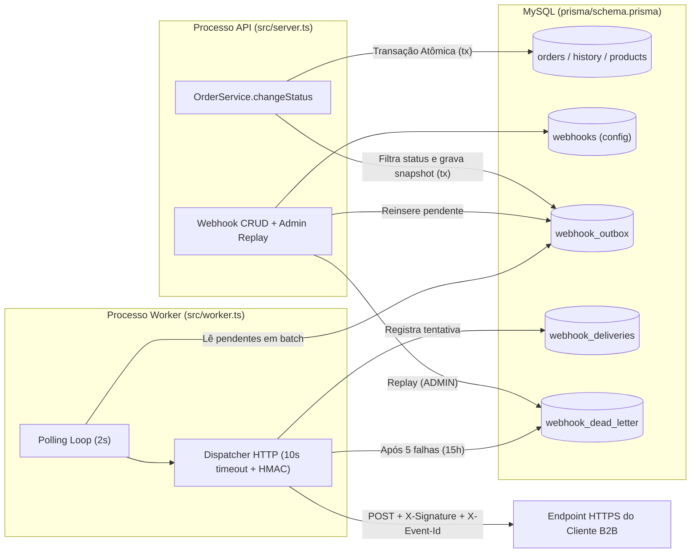

# RFC: Arquitetura do Sistema de Webhooks de Notificação de Pedidos (Outbound)

## 1. Metadados

| Campo | Valor |
| --- | --- |
| **ID do Documento** | `RFC-001` |
| **Título** | Sistema de Webhooks de Notificação de Mudança de Status de Pedidos |
| **Autor(a)** | Larissa (Tech Lead) |
| **Status** | Aprovado / Em Revisão Final pela Equipe |
| **Data** | 2026-11-05 |
| **Revisores** | Larissa (Tech Lead), Marcos (Product Manager), Bruno (Engenheiro Pleno — Time de Pedidos), Diego (Engenheiro Sênior — Time de Plataforma), Sofia (Engenheira de Segurança) |
| **Estimativa de Entrega** | 3 Sprints — inclui 2 dias úteis de revisão de segurança (`[09:46] Larissa`, `[09:46] Sofia`) |

---

## 2. Resumo Executivo (TL;DR)

Propomos a arquitetura de um **Sistema de Webhooks Outbound** para notificar clientes B2B (como Atlas Comercial, MaxDistribuição e Nova Cargo) sempre que o status de um pedido mudar no Order Management System (OMS) (`[09:00] Marcos`, `[09:03] Sofia`).

Para garantir **consistência transacional absoluta** sem degradar a latência ou a disponibilidade da API principal (`PATCH /api/v1/orders/:id/status`), a solução adota o padrão **Transactional Outbox no MySQL existente**: dentro da mesma transação SQL em `OrderService.changeStatus` (`src/modules/orders/order.service.ts`), o sistema grava o snapshot do evento na tabela `webhook_outbox` apenas para os endpoints inscritos naquele status (`[09:06] Diego`, `[09:34] Bruno`, `[09:40] Bruno`, `[09:52] Larissa`). Um **worker em processo Node.js separado (`src/worker.ts`)** consome a outbox via **polling a cada 2 segundos**, cumprindo com folga o SLA de negócio de entrega em menos de 10 segundos (`[09:02] Marcos`, `[09:09] Diego`, `[09:11] Diego`).

A arquitetura contempla **autenticação HMAC-SHA256 com secret exclusiva por endpoint e rotação com *grace period* de 24h**, **entrega *at-least-once* com `X-Event-Id` para deduplicação no cliente**, **política de até 5 retentativas com backoff exponencial (janela de ~15h)**, **Dead Letter Queue (DLQ) em tabela separada (`webhook_dead_letter`) com replay administrativo restrito à role `ADMIN`** e **reuso integral dos módulos e padrões existentes no código base** (`[09:48] Larissa`). O detalhamento de contratos HTTP, schemas e integração de código encontra-se no [FDD (`docs/FDD.md`)](./FDD.md).

---

## 3. Contexto e Problema

### 3.1 Problema de Negócio e Técnico (`RFC-CTX-01`)
Atualmente, o OMS possui uma máquina de estados controlada para pedidos (`PENDING`, `PAID`, `PROCESSING`, `SHIPPED`, `DELIVERED`, `CANCELLED` em `src/modules/orders/order.status.ts` e `prisma/schema.prisma`), mas não dispõe de nenhum mecanismo de notificação ativa de eventos (`[09:00] Marcos`). Três clientes B2B estratégicos — **Atlas Comercial**, **MaxDistribuição** e **Nova Cargo** — realizam polling repetitivo no endpoint `GET /api/v1/orders` para descobrir se houve atualização nos seus pedidos, tornando a integração lenta e custosa (`[09:00] Marcos`). A Atlas Comercial sinalizou risco de *churn* para o concorrente caso a funcionalidade não seja entregue até o fim do trimestre (`[09:00] Marcos`, `[09:45] Marcos`).

### 3.2 Restrições e Premissas Arquiteturais (`RFC-CTX-02`)
- **Direção da comunicação:** Exclusivamente *outbound* (do OMS para o cliente) (`[09:02] Marcos`, `[09:03] Sofia`).
- **Latência alvo ("tempo real"):** Qualquer entrega realizada em **menos de 10 segundos** após a mudança de status atende à expectativa dos clientes (`[09:02] Marcos`).
- **Invariante transacional:** A transação de mudança de status em `src/modules/orders/order.service.ts` já atualiza a tabela `orders`, insere histórico em `order_status_history` e debita/repõe estoque em `products` (`[09:04] Bruno`). O agendamento do webhook não pode bloquear essa transação com chamadas de rede nem permitir divergência entre o status persistido e os eventos gerados (`[09:06] Diego`, `[09:40] Bruno`).
- **Equipe e Infraestrutura:** Time enxuto operando Node.js + TypeScript + Express + Prisma + MySQL; deve-se evitar a introdução de novos brokers ou clusters externos desnecessários (`[09:07] Diego`, `[09:30] Larissa`).

---

## 4. Proposta Técnica (Visão Geral da Arquitetura)

A arquitetura proposta divide-se em quatro subsistemas coesos que reutilizam a infraestrutura atual do repositório:

### 4.1 Produtor Transacional (Transactional Outbox no MySQL) (`RFC-PROP-01`)
- Ao executar `OrderService.changeStatus` (`src/modules/orders/order.service.ts`), a mesma transação Prisma (`tx`) consulta os webhooks ativos do `customerId` inscritos no novo status (`toStatus`) (`[09:34] Bruno`, `[09:40] Bruno`).
- Se houver endpoints inscritos, insere-se na tabela `webhook_outbox` o evento com **snapshot do payload JSON já renderizado** no instante da mudança (evitando inconsistência caso o pedido mude novamente antes do envio) e limite máximo de **64KB** (`[09:24] Diego`, `[09:24] Larissa`, `[09:52] Larissa`).
- Se nenhum endpoint do cliente ouvir aquele status, nada é inserido na outbox (`[09:34] Bruno`).

### 4.2 Consumidor Assíncrono (Worker em Processo Separado) (`RFC-PROP-02`)
- Um processo independente inicializado via `src/worker.ts` (`npm run worker`) instancia seu próprio `PrismaClient` (`src/config/database.ts`) e executa um loop de **polling a cada 2 segundos** buscando lotes pequenos de eventos pendentes ordenados por `created_at` (`[09:08] Diego`, `[09:09] Diego`, `[09:11] Larissa`, `[09:30] Bruno`).
- A execução inicial em instância única (*single-worker*) garante ordenação implícita por `order_id` (`[09:12] Diego`, `[09:13] Larissa`).

### 4.3 Resiliência, Retries e Dead Letter Queue (`RFC-PROP-03`)
- Cada chamada HTTP `POST` possui **timeout de 10 segundos** (`[09:42] Diego`).
- Em caso de falha, aplica-se **backoff exponencial com até 5 tentativas**: `1m`, `5m`, `30m`, `2h` e `12h` (cobrindo ~15 horas de indisponibilidade do cliente) (`[09:16] Larissa`, `[09:17] Diego`, `[09:17] Larissa`).
- Esgotadas as 5 tentativas, o evento é movido para a tabela separada `webhook_dead_letter`, podendo ser reprocessado manualmente via `POST /api/v1/admin/webhooks/dead-letter/:id/replay` por usuários com role `ADMIN` (`requireRole('ADMIN')` de `src/middlewares/auth.middleware.ts`) com log de auditoria (`[09:18] Diego`, `[09:36] Sofia`, `[09:36] Larissa`).

### 4.4 Segurança, Idempotência e Gestão via API (`RFC-PROP-04`)
- **Segurança:** Exigência de URL `https://` via Zod (`[09:23] Sofia`), assinatura `HMAC-SHA256` em `X-Signature` usando secret exclusiva por endpoint, headers `X-Timestamp` e `X-Webhook-Id`, e endpoint de rotação de secret com **grace period de 24 horas** (`[09:20] Sofia`, `[09:21] Sofia`, `[09:44] Diego`, `[09:44] Sofia`).
- **Idempotência:** Entrega *at-least-once* com UUID único por evento enviado no header `X-Event-Id` e no payload para deduplicação pelo cliente (`[09:24] Diego`, `[09:25] Diego`).
- **API de Gestão e Histórico:** Endpoints autenticados via JWT (`authenticate`) em `src/modules/webhooks` para CRUD de webhooks por `customerId` e consulta das últimas 100 entregas (`GET /api/v1/webhooks/:id/deliveries`) (`[09:31] Marcos`, `[09:32] Larissa`, `[09:33] Bruno`, `[09:34] Marcos`).

---

## 5. Alternativas Consideradas

A tabela abaixo sintetiza as alternativas reais discutidas durante a reunião técnica e os trade-offs que motivaram seu descarte:

| ID | Alternativa Considerada | Discussão | Trade-off e Motivo do Descarte |
| --- | --- | --- | --- |
| `RFC-ALT-01` | **Disparo HTTP síncrono dentro de `OrderService.changeStatus`** | `[09:03] Larissa` `[09:04] Bruno` `[09:06] Diego` | **Descartada.** Embora eliminasse a necessidade de tabela outbox e worker, acoplaria uma chamada HTTP externa a uma transação SQL pesada (que atualiza `orders`, `order_status_history` e `products`). Qualquer lentidão do cliente travaria mudanças de status de outros pedidos, e uma queda do cliente criaria o dilema inaceitável de dar *rollback* na mudança de status do pedido. |
| `RFC-ALT-02` | **Uso de Redis Streams / Redis Cluster como fila de eventos** | `[09:07] Larissa` `[09:07] Diego` | **Descartada.** Ofereceria consumo reativo de alta vazão, mas exigiria provisionar, operar e monitorar infraestrutura adicional para um time pequeno (*overengineering*). O padrão Outbox no MySQL existente resolve o problema com garantia transacional nativa na mesma conexão Prisma. |
| `RFC-ALT-03` | **Triggers no MySQL para acionar o Worker reativamente** | `[09:09] Bruno` `[09:09] Diego` | **Descartada.** Evitaria consultas periódicas de polling, porém o MySQL não possui mecanismo nativo equivalente ao `LISTEN/NOTIFY` do PostgreSQL. Triggers no MySQL executam apenas SQL e exigiriam gambiarras externas (arquivos ou chamadas HTTP do banco), enquanto o polling de 2s atende perfeitamente ao SLA < 10s. |
| `RFC-ALT-04` | **Retry indefinido ou limite curto de 3 tentativas (30 min)** | `[09:15] Diego` `[09:16] Bruno` `[09:16] Diego` | **Descartada.** Retry indefinido deixaria eventos pendurados eternamente caso um cliente abandonasse o endpoint; por outro lado, 3 tentativas em 30 minutos descartaria eventos precocemente durante manutenções planejadas de clientes (já observadas com duração de ~2 horas). O meio-termo de 5 tentativas (~15h) equilibra retenção e limpeza. |
| `RFC-ALT-05` | **Marcar eventos mortos apenas como `failed` na própria `webhook_outbox`** | `[09:17] Larissa` `[09:18] Diego` | **Descartada.** Simplificaria o schema em uma tabela a menos, mas degradaria a leitura da `webhook_outbox` principal com o acúmulo de falhas permanentes. A tabela separada `webhook_dead_letter` mantém a outbox limpa e isola as evidências para debug e replay. |
| `RFC-ALT-06` | **Garantia de entrega *Exactly-Once*** | `[09:24] Diego` `[09:25] Sofia` `[09:25] Diego` | **Descartada.** Evitaria que o cliente precisasse deduplicar eventos, mas exigiria coordenação distribuída complexa entre os dois lados. A entrega *at-least-once* com `X-Event-Id` segue o padrão de mercado (Stripe, GitHub) e resolve 99% dos cenários com baixa complexidade. |

---

## 6. Questões em Aberto

Os seguintes pontos foram levantados na reunião e deliberadamente adiados ou mantidos em observação para ciclos futuros:

1. **Rate Limiting de Saída por Cliente (`RFC-OPEN-01`):**
   - *Contexto:* Se um cliente tiver 50 pedidos mudando de status em um minuto, o worker enviará 50 requisições quase simultâneas para o endpoint dele (`[09:38] Diego`).
   - *Direcionamento:* Não entrará no escopo inicial. Vamos monitorar o comportamento em produção e implementar controle de taxa (*rate limiting* / *throttling* por endpoint) apenas se se tornar um problema real (`[09:39] Diego`, `[09:39] Larissa`).
2. **Escalabilidade Horizontal de Múltiplos Workers vs. Ordenação (`RFC-OPEN-02`):**
   - *Contexto:* A ordenação por `order_id` é garantida naturalmente enquanto houver apenas um worker lendo por `created_at`. Se escalarmos para múltiplos workers em paralelo no futuro, essa garantia implícita se perde (`[09:12] Diego`).
   - *Direcionamento:* Documentado como limitação conhecida do MVP. Quando houver necessidade de escalar múltiplos workers, decidiremos entre particionamento por `order_id` ou *locking* pessimista no banco (`[09:13] Bruno`, `[09:13] Diego`, `[09:13] Larissa`).
3. **Endurecimento de Permissões (RBAC/Ownership) no CRUD de Webhooks (`RFC-OPEN-03`):**
   - *Contexto:* No lançamento inicial, qualquer usuário autenticado via JWT (`ADMIN` ou `OPERATOR`) poderá operar os endpoints de CRUD de configuração de webhooks informando o `customerId` (`[09:36] Marcos`, `[09:37] Sofia`).
   - *Direcionamento:* Aceito para o MVP, devendo ser reavaliado futuramente para endurecer o isolamento de permissões por cliente/role (`[09:37] Sofia`).
4. **Política Automatizada de Arquivamento/Expurgo da Outbox (`RFC-OPEN-04`):**
   - *Contexto:* Eventos marcados como entregues na `webhook_outbox` acumularão volume ao longo dos meses (`[09:07] Bruno`).
   - *Direcionamento:* A rotina de arquivamento/limpeza de linhas entregues após ~30 dias foi deixada fora do escopo desta entrega e será definida posteriormente (`[09:08] Diego`).
5. **Notificação Proativa por E-mail em Caso de Falhas Repetidas (`RFC-OPEN-05`):**
   - *Contexto:* Alertar o cliente por e-mail quando seu endpoint falhar consecutivamente (ex.: 3 falhas seguidas) (`[09:37] Marcos`).
   - *Direcionamento:* Adiado para uma próxima fase após medição do impacto operacional da primeira versão (`[09:37] Larissa`, `[09:38] Marcos`).

---

## 7. Impacto e Riscos

| Impacto / Risco | Descrição e Mitigação Arquitetural |
| --- | --- |
| **Aumento de Escrita e Armazenamento no MySQL** | Toda transição de status com webhook ativo adiciona escritas na `webhook_outbox` e em `webhook_deliveries`. **Mitigação:** Filtragem na inserção (não grava se o cliente não assina o status, `[09:34] Bruno`), payload enxuto sem `items` (`[09:43] Diego`), teto de 64KB (`[09:24] Diego`), índices em `(status, created_at)` e tabela `webhook_dead_letter` separada (`[09:08] Diego`, `[09:18] Diego`). |
| **Degradação do Worker por Endpoints de Clientes Lentos** | Clientes que demoram a responder podem atrasar o lote do worker. **Mitigação:** Processo isolado da API (`src/worker.ts`, `[09:11] Diego`), leitura em lotes pequenos (`[09:08] Diego`) e timeout rígido de 10 segundos por chamada HTTP (`[09:42] Diego`). |
| **Vazamento de Secrets ou Falha na Implementação Criptográfica** | Risco de exposição de chaves ou erro na validação de assinatura HMAC e rotação. **Mitigação:** Secret individual por endpoint, rotação com grace period de 24h (`[09:21] Sofia`), redaction no logger Pino (`src/shared/logger/index.ts`) e janela obrigatória de 2 dias úteis de revisão de código por Segurança (Sofia) antes do deploy (`[09:46] Sofia`). |
| **Impacto no Fluxo Crítico de Pedidos (`OrderService.changeStatus`)** | Como a inserção na outbox ocorre dentro da transação de mudança de status, um bug na função `publishWebhookEvent` causaria rollback na mudança de status do pedido (`[09:40] Bruno`). **Mitigação:** Função pura e enxuta recebendo `tx` (`[09:41] Bruno`, `[09:41] Diego`) coberta por testes de integração ponta a ponta na Sprint 3 (`[09:46] Larissa`). |

---

## 8. Decisões Relacionadas (ADRs)

Todas as decisões arquiteturais estruturantes desta proposta estão formalizadas nos seguintes *Architecture Decision Records*:

- **[ADR-001: Padrão Transactional Outbox no MySQL para Eventos de Webhook](./adrs/ADR-001-outbox-no-mysql.md)** — Justifica a inserção atômica na mesma transação do Prisma, filtragem na inserção e snapshot do payload.
- **[ADR-002: Worker em Processo Separado Consumindo a Outbox via Polling](./adrs/ADR-002-worker-em-processo-separado-em-polling.md)** — Define o entry-point `src/worker.ts`, intervalo de polling de 2 segundos e execução *single-worker* inicial.
- **[ADR-003: Política de Retry com Backoff Exponencial e Dead Letter Queue (DLQ) em Tabela Separada](./adrs/ADR-003-politica-de-retry-com-backoff-e-dlq.md)** — Formaliza as 5 tentativas (`1m/5m/30m/2h/12h`), timeout de 10s, tabela `webhook_dead_letter` e replay manual via role `ADMIN`.
- **[ADR-004: Autenticação de Webhooks com HMAC-SHA256, Secret por Endpoint e Rotação com Grace Period](./adrs/ADR-004-autenticacao-hmac-sha256-com-secret-por-endpoint.md)** — Especifica a assinatura `X-Signature`, obrigatoriedade de HTTPS e rotação com validade paralela de 24h.
- **[ADR-005: Semântica de Entrega At-Least-Once e Idempotência no Cliente via X-Event-Id](./adrs/ADR-005-garantia-at-least-once-com-x-event-id.md)** — Define a garantia de entrega e o contrato de deduplicação pelo cliente.
- **[ADR-006: Reuso Integral dos Padrões Arquiteturais, de Erros, Validação e Logging do Código Existente](./adrs/ADR-006-reuso-dos-padroes-existentes-do-projeto.md)** — Determina o reuso da estrutura `src/modules/webhooks`, `AppError` com prefixo `WEBHOOK_*`, `errorMiddleware`, Zod e Pino.
